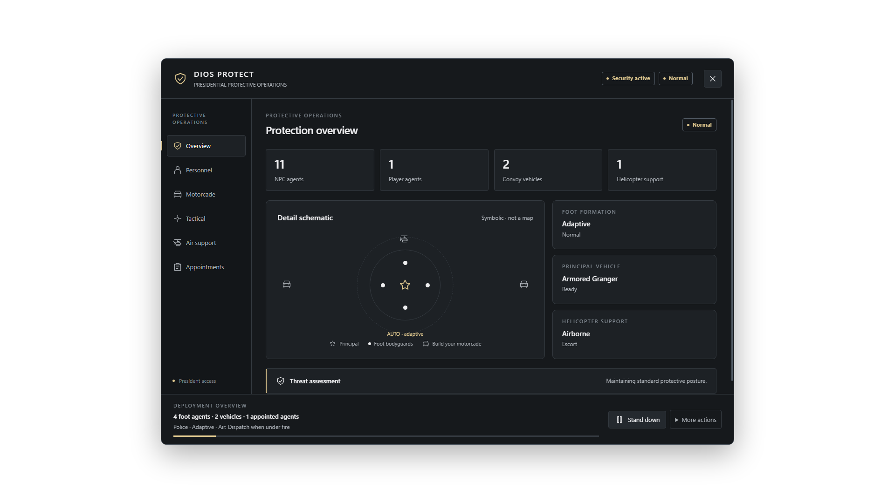
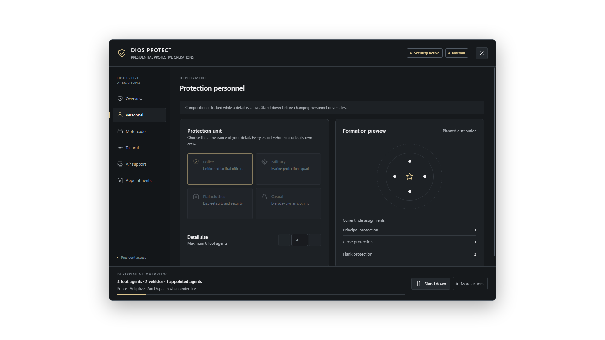
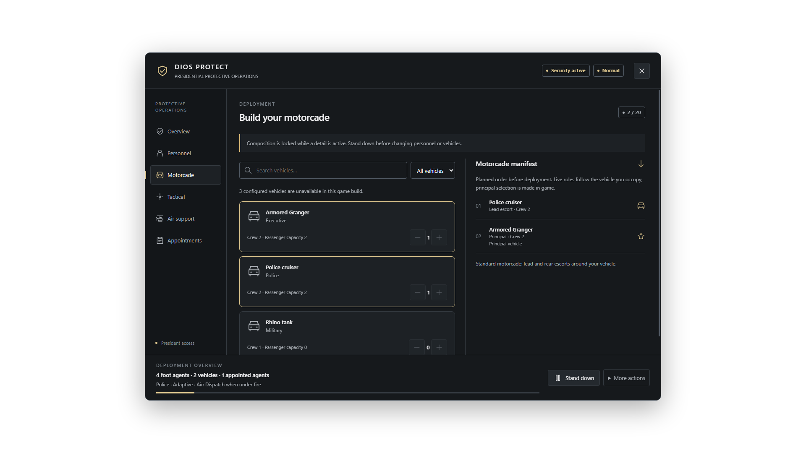
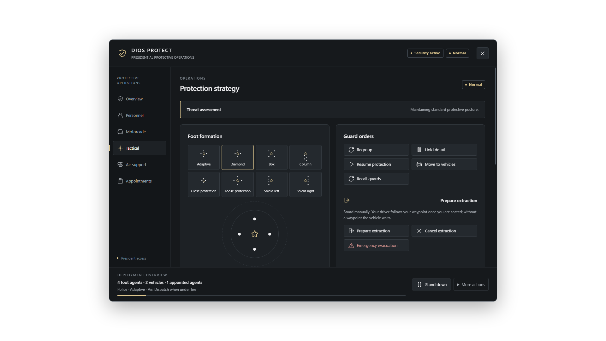
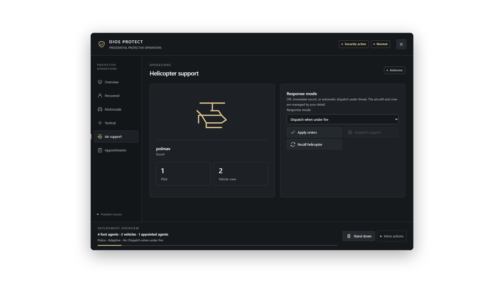
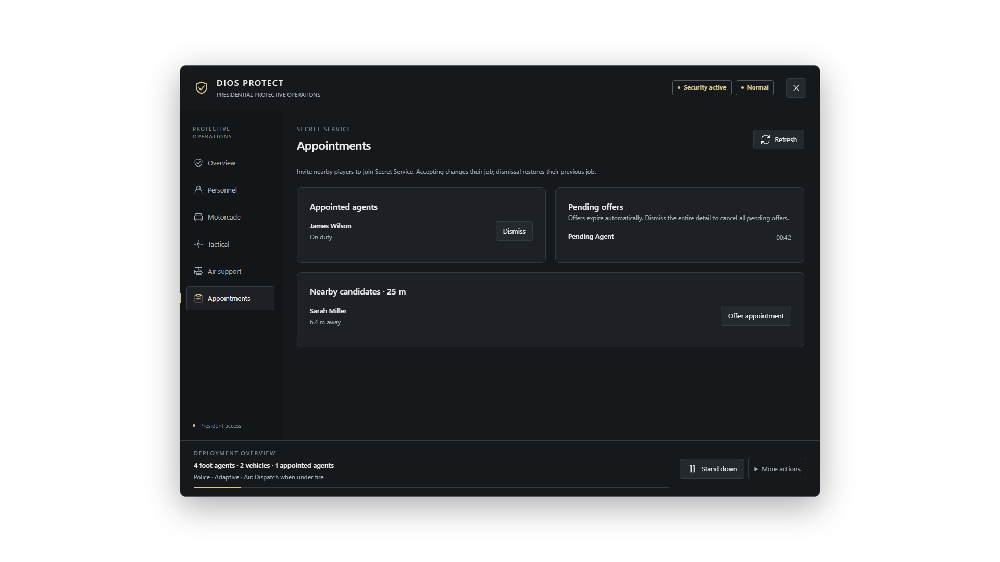
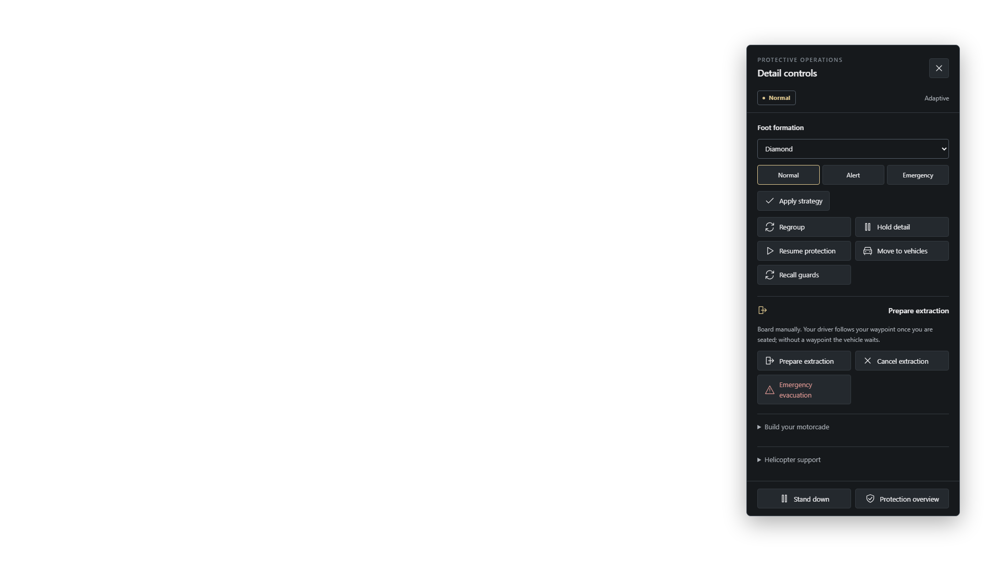

<div align="center">

# Dios Protect

### Presidential protection, motorcades & tactical operations for FiveM

An open-source resource by **Dios Scripts**. Build a protection detail, appoint player agents, coordinate escorts and manage helicopter support from one operations console.


[Features](#features) · [UI previews](#ui-previews) · [Installation](#installation) · [Integrations](#integrations) · [Testing status](#testing-status)

</div>



## Features

- **Protection details** — police, military, plainclothes and casual NPCs; configurable models, equipment and capacity limits.
- **Foot formations** — Adaptive, Diamond, Box, Column, Close, Loose, Left and Right. Adaptive switches its base formation for interiors and detected obstructions.
- **Motorcades** — configurable escort quantities, lead/rear roles, convoy spacing, driving styles and chauffeur controls.
- **Tactical operations** — threat states, role allocation, regroup, hold, resume and extraction commands.
- **Helicopter support** — dispatch, recall, escort and automatic support with availability and cooldown feedback.
- **Player appointments** — consent-based invitations, agent management and recovery of previous framework jobs through a persistent resource journal.
- **Two interfaces** — a six-page operations dashboard and a compact control panel for use during gameplay.
- **Environment detection** — reports Legacy/Enhanced, framework and active key adapters; warns about potential spawn suppression conflicts.
- **Five languages** — English, Spanish, Dutch, German and Hindi, with English fallback and editable locale catalogs.

Callbacks, model loading, notifications and invitation dialogs are implemented inside the resource. No `ox_lib`, inventory or targeting resource is required by Dios Protect itself. UI assets are local: no CDN, external fonts or frontend build step.

## UI previews

These screenshots show the shipped interface in Chromium with sample data. They are **browser previews**, not in-game screenshots or evidence of gameplay validation. Formation diagrams are symbolic.

| Personnel | Motorcade |
| :---: | :---: |
|  |  |
| **Tactical** | **Air support** |
|  |  |

<details>
<summary>Appointments and compact controls</summary>




</details>

## Installation

**Required:** FiveM with OneSync enabled. A supported framework and vehicle-key provider are optional.

```text
dios-protect/
|-- dios_protect/        # Ready-to-copy production resource
|   |-- fxmanifest.lua
|   |-- client/
|   |-- config/
|   |-- locales/
|   |-- server/
|   |-- shared/
|   `-- web/
|-- docs/                # Guides, installation examples and UI previews
|-- README.md
`-- LICENSE
```

1. Download or clone this repository.
2. Copy the included **`dios_protect` folder** directly into your server's `resources/[local]/` directory. Keep its name `dios_protect`; no folder assembly is needed. Leave repository documentation outside your server resources.
3. Edit [dios_protect/config/config.lua](dios_protect/config/config.lua). Framework and key detection default to `auto`; configure renamed resources in `integration.resources` and `keyResources`.
4. Start your framework and key resources first, then add this to `server.cfg`:

   ```cfg
   set onesync on
   ensure dios_protect
   ```

5. Grant access using one of the methods below. Join outdoors near a clear road, open `/protect` and start with a small detail.

### Standalone access

Grant the configured President ACE to the intended player's real identifier:

```cfg
add_ace identifier.license:YOUR_PLAYER_LICENSE dios_protect.president allow
```

The resource does not automatically grant President access. Standalone appointments are resource-local assignments and have no framework payroll.

### Framework access

Assign the configured `president` job through your framework's administration tools. Minimum grade and duty requirements are configurable.

Falcon, QBox and QBCore can register missing jobs when `integration.createJobs=true`. For **ESX Legacy**, import [docs/install/esx.sql](docs/install/esx.sql) into the existing framework database, then restart ESX before starting Dios Protect. Adjust the SQL if you rename the jobs or use a different schema.

### Spawn restrictions

Resources such as `qb-smallresources` can suppress models or delete entities. Startup warnings identify potential conflicts; they do not automatically disable other resources or prove a conflict exists.

For an existing server blacklist, adapt [docs/install/blacklist-example.lua](docs/install/blacklist-example.lua) to use the server-only `IsProtectedEntity` export. The export checks the private protection registry; replicated state bags and plate text do not authorize exemptions.

## Commands

| Command | Purpose |
| --- | --- |
| `/protect` | Open the President's operations dashboard. |
| `/detailcontrol` | Open compact live controls for an active detail. |
| `/detailstatus` | Print client diagnostics, including formation slot error and movement speeds, to F8. |
| `protectenvironment` | **Server console:** print environment diagnostics and rescan potential spawn conflicts. |

Command names can be changed in `Protect.commands`.

**Stand down** removes NPC security while retaining player appointments. **Disband convoy** removes ground escorts and their crews. **Dismiss entire detail** removes NPC units, cancels offers and restores appointed players' previous jobs where applicable.

## Integrations

| Framework mode | Resource |
| --- | --- |
| Falcon | `falcon_core` |
| QBox | `qbx_core` |
| QBCore | `qb-core` |
| ESX Legacy | `es_extended` |
| Standalone | ACE access; no core required |

Automatic framework priority is Falcon → QBox → QBCore → ESX → standalone. Explicit selection is supported. Restart Dios Protect after a core restart to refresh its adapter.

Vehicle-key adapters are included for **QBox, QBCore, Wasabi, Renewed, MrNewb, ZRX, Jaksam, Quasar, Codesign, okok, T1ger, MK and both AK47 variants**. Automatic mode uses every detected provider; with no provider, native doors are unlocked without requiring a plate. Custom integrations live in [dios_protect/config/integration.lua](dios_protect/config/integration.lua).

See [vehicle-key integration details](docs/KEYS.md) for resource names, API expectations and verification limitations. Provider versions differ; test entry, locking, unlocking and re-entry with your installed resources.

## Configuration

[dios_protect/config/config.lua](dios_protect/config/config.lua) groups access, jobs, UI branding, guard models, vehicle catalogs, driving behavior, performance and tactical settings. Change the language with `Protect.locale`: `en`, `es`, `nl`, `de` or `hi`.

The default foot supervisor runs every 50 ms. Moving slots use bounded velocity/turn prediction; NPCs still navigate through the game world. Guards and drivers are tasked only by their current network owner. Formation movement does not use teleports or rigid attachments.

Player appointments use resource KVP storage. Preserve that storage when migrating servers so previous jobs can be restored. Deployment failures roll back partial NPC details; they do not silently grant missing keys.

## Testing status

**Current version: `2.5.0-rc1` — release candidate.**

The resource identifies and targets both GTA Legacy and GTA Enhanced. Real standalone server lifecycle checks have passed on both installed runtimes. The current development checks report **36 Lua/resource tests** and **286 browser assertions**; tests and development dependencies are kept outside this production repository.

Connected Legacy testing has confirmed better settled formations, but **walking formation maintenance remains under live validation** after the latest movement correction. Enhanced gameplay and the full framework/key-provider matrix also need connected-client testing. This repository does not claim complete in-game certification across every combination.

## Feedback

Use [GitHub Issues](https://github.com/DiosDevelopment/dios-protect/issues) for bugs and suggestions. For bugs, include the GTA edition, server artifact/build, framework, key providers, selected guards/vehicles and reproduction steps. Include relevant F8/server diagnostics; omit license identifiers, tokens and server secrets.

## License

Released under [GNU GPLv3](LICENSE). Free, readable source with no asset escrow or encryption.

<div align="center">

**Dios Scripts · Dios Development**

</div>
